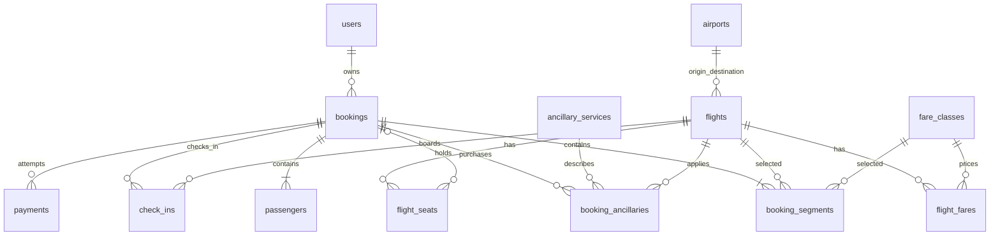
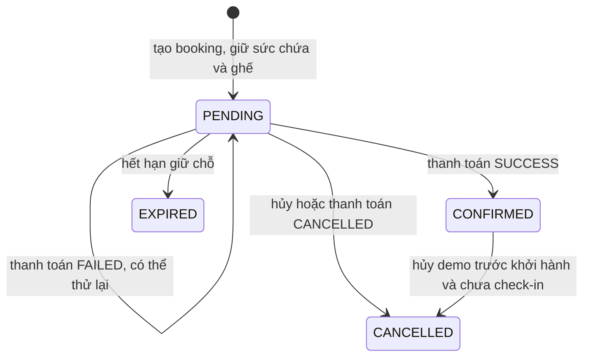

# Database và tính toàn vẹn

PostgreSQL 17. Flyway V1 tạo schema, V2 tạo catalog, V3 cập nhật banner, V4–V7 bổ sung nghiệp vụ nội bộ, V8 bổ sung sáu banner để trang chủ đủ chín chiến dịch; Hibernate chỉ `validate`, Open Session in View tắt. Tiền dùng `NUMERIC(14,2)`/BigDecimal; thời điểm lưu `TIMESTAMPTZ`/Instant UTC, ngày sinh dùng DATE/LocalDate. Hiển thị và ngày tìm chuyến theo Asia/Ho_Chi_Minh.

`promotion_codes` chứa cấu hình mã giảm giá; booking lưu mã và số tiền giảm đã chốt. `content_items` lưu nội dung trang chủ có category/sort_order/image/target; hai bảng độc lập này không xuất hiện trong quan hệ ERD phía trên. `check_ins` được thêm để lưu boarding pass và trạng thái theo hành khách/chặng. Không tạo bảng routes vì cặp origin/destination trên flights đủ cho phạm vi demo. Quản trị nội dung dùng lại `content_items`; session frontend vẫn nằm trong trình duyệt.

## Constraint và index

- PK bigint tự tăng. FK từ flight tới hai sân bay; fare/seat tới flight; segment/passenger/ancillary/payment/check-in tới booking, và các bảng danh mục liên quan.
- Unique mã sân bay, email, mã booking, token booking, fare code và promotion code; chuyến theo flight_number/departure_time; fare theo flight/fare_class; ghế theo flight/seat_number.
- Segment không lặp booking/flight hoặc booking/segment_index; passenger không lặp booking/passenger_index. Ghế có unique flight/booking/passenger_index khi được giữ. Service không lặp booking/flight/service/passenger.
- Payment request_key UUID unique; partial unique index đảm bảo mỗi booking có tối đa một payment SUCCESS. Check-in unique booking/flight/passenger và flight/seat, boarding_code unique.
- CHECK cho trạng thái, giá không âm, capacity dương, sân bay khác nhau, arrival sau departure và cặp booking_id/passenger_index cùng null hoặc cùng có dữ liệu trên ghế.
- Index tìm chuyến theo origin/destination/departure; tìm segment theo flight/booking; quét booking hết hạn theo status/expires_at.

## Dữ liệu demo

9 sân bay: HAN, SGN, DAD, PQC, CXR, DLI, VII, VDH, PXU. Có 22 tuyến theo hai hướng, SGN↔HAN ba khung giờ/ngày; tổng 26 chuyến/ngày. Mặc định 90 ngày là 2.340 chuyến, mỗi chuyến 72 ghế trong sơ đồ, ghế 12F bị khóa, capacity 71; tổng 168.480 bản ghi ghế khi seed một cửa sổ 90 ngày mới.

Seed kiểm tra tồn tại theo mã/ngày nên không trùng và không xóa booking cũ. Khi thời gian tiến lên, số bản ghi tổng có thể lớn hơn các con số trên. Tạo thêm lịch mỗi 00:05 Asia/Ho_Chi_Minh và mỗi lần khởi động. Bốn hạng Eco/Deluxe/SkyBoss/Business, sáu dịch vụ mẫu và DEMO10 được lưu database. Banner/destination/FAQ cũng từ catalog.

## Vòng đời booking

- Tạo booking khóa flight theo ID tăng dần bằng `PESSIMISTIC_WRITE`, kiểm tra capacity dựa trên segment của CONFIRMED hoặc PENDING chưa hết hạn, kiểm tra và gán ghế trong cùng transaction. Hai yêu cầu chọn cùng ghế hoặc suất cuối không thể cùng thành công.
- Thanh toán/hủy/check-in khóa booking trước, sau đó các flight theo thứ tự tăng dần. Giá, thuế, extras và giảm giá được chốt khi tạo booking; payment dùng tổng đã lưu, không nhận tổng tiền từ client.
- Giữ chỗ mặc định 15 phút. Job mỗi 60 giây đổi trạng thái hết hạn và giải phóng ghế. API đọc hiển thị EXPIRED ngay khi thời hạn đã qua; tính capacity và kiểm tra ghế bỏ qua hold đã hết hạn, không đợi job.
- SUCCESS idempotent theo request key; gọi SUCCESS với key mới trên booking CONFIRMED trả payment thành công cũ. Key đã dùng cho booking/kết quả khác trả 409. FAILED không xác nhận booking. CANCELLED giải phóng chỗ.
- Check-in chỉ booking CONFIRMED, trong cửa sổ demo cấu hình. Lần lặp cùng passenger/flight/seat trả trạng thái cũ; đổi ghế sau check-in hoặc trùng ghế trả xung đột. Không hủy booking đã check-in.
- Em bé không chiếm ghế, không được gán ghế hoặc ancillary riêng. Tối thiểu một người lớn, infants ≤ adults, thường tối đa 9 hành khách, GROUP tối đa 30; tuổi được kiểm tra ở backend.

## Công thức giá demo

`base = tổng(giá hạng mỗi chặng × (adults + children × 0,75 + infants × 0,10))`.

`tax = 120.000 × (adults + children) × số chặng`. Extras là dịch vụ đã chọn theo người/chặng cộng ghế; ghế tiêu chuẩn miễn phí khi fare có seat_included, ghế đặc biệt vẫn tính giá. DEMO10 giảm 10% base, tối đa 200.000. `total = base + tax + extras − discount`. Không đại diện biểu giá/thuế/quyền lợi chính thức của hãng.

## Migrations nghiệp vụ nội bộ

| Migration | Dữ liệu bổ sung |
|---|---|
| V4 | users.phone/token_version/reset_hash/reset_expires_at; saved_travelers; support_tickets/support_messages; mail_messages |
| V5 | bookings.revision/adjustment_amount; booking_changes, change_payments; refund_requests |
| V6 | users.points/qualifying_spend; gift_vouchers/voucher_usages; point_entries; shop_products/shop_orders/shop_order_items; commerce_payments |
| V7 | bookings.journey_type; chuyển booking hai chặng cũ sang ROUND_TRIP |
| V8 | thêm sáu bản ghi HERO vào content_items; không đổi schema hoặc dữ liệu giao dịch |

Migrations bổ sung schema, giữ booking/tài khoản cũ; Hibernate validate schema sau Flyway. Reset token lưu SHA-256 thay vì token gốc; outbox demo chứa đường dẫn dùng một lần và chỉ ADMIN đọc. token_version khiến JWT cũ mất hiệu lực sau đổi/khôi phục mật khẩu.

Booking change lưu payload và revision lúc báo giá; thanh toán kiểm tra lại hạn/revision/giá trước khi chuyển ghế/chặng nguyên tử. Phí đổi và phần giá giảm không hoàn lưu adjustment_amount, được tính vào tổng và loại khỏi hoàn. refund_requests unique booking; xử lý lặp COMPLETED trả kết quả cũ.

Voucher lưu người mua, email người nhận, mệnh giá/số dư/hạn dùng và cờ đổi thưởng; voucher_usages unique booking/request_key. Khi hoàn, khóa voucher và đánh dấu refunded để không trả số dư hai lần. point_entries unique source chống cộng/đảo lặp, khóa user trước tích/đổi; số dư điểm có thể âm sau hoàn nếu điểm đã đổi thưởng trước đó.

Kho khóa sản phẩm theo ID tăng dần, trừ tồn khả dụng khi tạo đơn; snapshot giá/tên ở dòng đơn. Job hết hạn và hủy trả kho một lần; PAID/FULFILLED không hết hạn. commerce_payments và change_payments lưu các lần thanh toán với UUID unique, gồm cả kết quả thất bại. Dữ liệu vận hành không dùng mock database.
